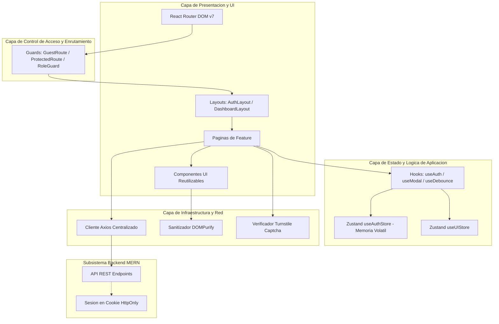
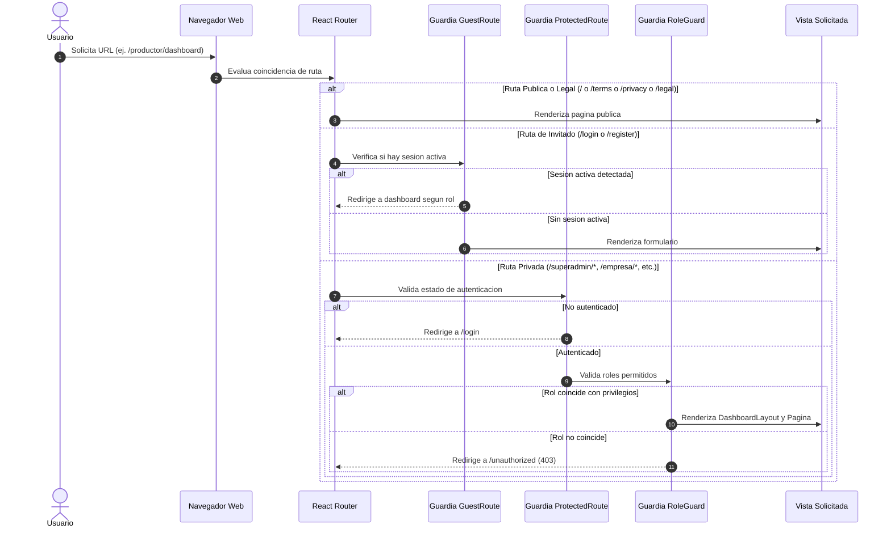
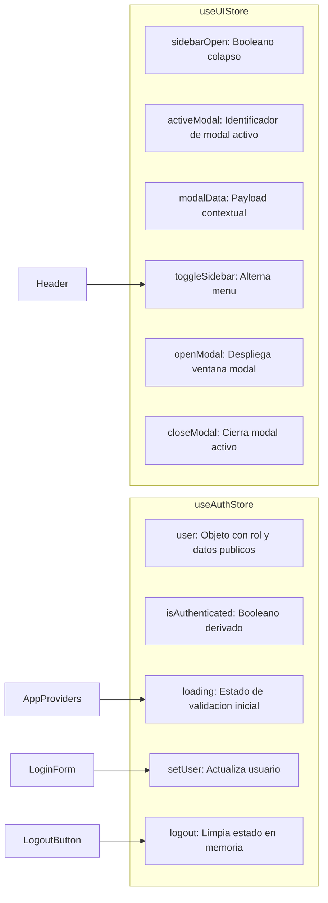

# Informe de Arquitectura de Software — ConexCoffee Frontend

## 1. Introducción y Propósito

El presente documento técnico describe la arquitectura de software del subsistema frontend de la plataforma **ConexCoffee**. Su objetivo es proporcionar una referencia formal y exhaustiva para el equipo de desarrollo, arquitectos de software e ingenieros que deban mantener, auditar o expandir el sistema a lo largo de su ciclo de vida.

---

## 2. Atributos de Calidad y Principios de Diseño

El diseño de la aplicación responde a cuatro atributos de calidad principales:

1. **Escalabilidad**: Capacidad para incorporar nuevos dominios de negocio, roles de usuario y submódulos sin generar acoplamiento tangencial ni degradar el rendimiento.
2. **Seguridad en Profundidad**: Mitigación sistemática de riesgos habituales en aplicaciones cliente (XSS, CSRF, suplantación de identidad y almacenamiento indebido de credenciales).
3. **Mantenibilidad y Legibilidad**: Organización intuitiva orientada al dominio de negocio, donde la estructura de carpetas refleja directamente el propósito funcional de cada módulo.
4. **Resiliencia**: Manejo controlado de excepciones mediante barreras de error en React, estados de carga coherentes y retroalimentación explícita de errores al usuario.

---

## 3. Diagrama de Arquitectura de Alto Nivel (Capas del Sistema)

La aplicación implementa una arquitectura en capas unidireccional, donde cada nivel posee responsabilidades delimitadas y no interactúa con niveles superiores.



---

## 4. Topología de Roles y Control de Acceso

La plataforma contempla cinco perfiles de usuario autenticados, además de los visitantes públicos:

| Rol | Identificador | Alcance y Módulos Asignados |
| :--- | :--- | :--- |
| **Público / Invitado** | `guest` | Portal comercial (Landing), Términos y Condiciones, Política de Privacidad, Aviso Legal, Formularios de Login y Registro con Captcha. |
| **SuperAdmin** | `superadmin` | Supervisión total de la plataforma, métricas globales del sistema, gestión de usuarios, auditoría de transacciones y configuración. |
| **Empresa** | `empresa` | Gestión de compras corporativas, catálogo empresarial, órdenes de compra de café y seguimiento logístico. |
| **Broker** | `broker` | Intermediación de ofertas, gestión de contratos comerciales, comisiones, acuerdos bilaterales y negociaciones. |
| **Caficultor** | `caficultor` | Publicación y administración de lotes de café pergamino seco, fincas, certificaciones de origen, rendimientos y control de ofertas. |
| **Laboratorio** | `laboratorio` | Análisis físico-químico, control de humedad, factor de rendimiento, merma y emisión de certificados de calidad de café verde. |
| **Técnico / Asistente Técnico** | `tecnico` | Acompañamiento agronómico en campo, visitas a fincas cafetaleras, auditorías de Buenas Prácticas Agrícolas (BPA) y georreferenciación. |
| **Catador** | `catador` | Evaluación sensorial bajo protocolo SCA, perfiles de taza, descriptores aromáticos y asignación de puntajes a lotes de café especial. |
| **Comprador** | `comprador` | Exploración de lotes de café pergamino seco, solicitudes de muestra, compras directas y seguimiento de contenedores y pedidos. |

---

## 5. Diagrama de Flujo de Navegación y Guards

El acceso a cualquier ruta dentro de la aplicación es evaluado por una jerarquía de guardias de navegación antes de permitir el renderizado del componente correspondiente:



---

## 6. Modelo de Autenticación y Seguridad en Red

A fin de cumplir con las directrices de seguridad de la plataforma, se implementó una estrategia de autenticación libre de persistencia vulnerable en el almacenamiento local del navegador:

### Principios de Seguridad Aplicados

1. **Gestión de Sesión vía Cookies HttpOnly**:
   - Los tokens JWT emitidos por el backend residen exclusivamente en cookies marcadas con las directivas `HttpOnly`, `Secure` y `SameSite=Lax` (o `Strict`).
   - El código JavaScript ejecutado en el cliente no posee lectura directa de la credencial, anulando vectores de ataque de extracción por inyección de scripts.
2. **Configuración de Axios**:
   - Se establece `withCredentials: true` en la instancia global (`src/lib/axios.js`), garantizando que cada petición a la API viaje acompañada de la cookie de sesión correspondiente.
3. **Manejo Centralizado de Expiración (Interceptor 401)**:
   - Toda respuesta de red con código HTTP 401 desencadena automáticamente la invalidación del estado de sesión en Zustand (`setUser(null)`) y redirige al flujo de autenticación.
4. **Verificación Antibot (Cloudflare Turnstile)**:
   - Se implementa el componente `Captcha.jsx` para generar un token criptográfico previo al envío de formularios sensibles (inicio de sesión y creación de cuentas).

```mermaid
sequenceDiagram
    autonumber
    actor Usuario
    participant UI as Formulario Login/Register
    participant Captcha as Componente Captcha
    participant Axios as Cliente Axios
    participant Backend as Servidor Backend
    participant Store as Zustand AuthStore

    Usuario->>UI: Ingresa credenciales
    Usuario->>Captcha: Resuelve reto de seguridad
    Captcha-->>UI: Retorna captchaToken
    Usuario->>UI: Presiona Enviar
    UI->>Axios: POST /api/auth/login { email, password, captchaToken }
    Axios->>Backend: Envio de credenciales con credenciales de origen
    Backend->>Backend: Valida captcha y credenciales
    Backend-->>Axios: HTTP 200 OK + Set-Cookie: token=...; HttpOnly + JSON { user }
    Axios-->>UI: Retorna respuesta estructurada
    UI->>Store: setUser(user) [Solo datos de perfil en memoria]
    UI->>Usuario: Redireccion automatica al Dashboard del rol
```

---

## 7. Descomposición Modular de Carpetas

La arquitectura orientada a funcionalidades segmenta el código por dominio de negocio. Cada funcionalidad encapsula su lógica y solo expone componentes estables:

```
src/features/<nombre-de-la-feature>/
├── api/
│   └── <feature>Api.js           # Consultas al backend dedicadas al modulo
├── components/                   # Componentes visuales internos del modulo
│   ├── SubComponenteA.jsx
│   └── SubComponenteB.jsx
├── hooks/                        # Logica reutilizable exclusiva del modulo
│   └── use<Feature>.js
├── pages/                        # Contenedores de vista enlazados al Router
│   └── <Feature>Page.jsx
└── index.js                      # Interfaz publica (Barrel export)
```

### Relación de Módulos Implementados

- **`features/landing`**: Contiene la presentación pública del servicio, secciones promocionales, navegación principal y pie de página institucional.
- **`features/auth`**: Gestiona el inicio de sesión, registro de nuevos usuarios, páginas informativas de error 404 y 403, y hooks de sesión.
- **`features/legal`**: Agrupa los contratos y normativas de la plataforma: Términos y Condiciones, Política de Privacidad y Aviso Legal.
- **`features/superadmin`**: Panel analítico de control operativo, gestión de cuentas y métricas del sistema.
- **`features/empresa`**: Operaciones de compañías y cooperativas de compra mayorista.
- **`features/broker`**: Herramientas de negociación, comisiones y articulación entre partes.
- **`features/caficultor`**: Panel de producción agrícola, fincas, catalogación de lotes de pergamino seco y ofertas.
- **`features/laboratorio`**: Análisis físico-químico, control de humedad y certificación de calidad de muestras.
- **`features/tecnico`**: Acompañamiento agronómico en campo, registro de visitas técnicas y auditorías de fincas.
- **`features/catador`**: Catación sensorial bajo protocolo SCA, perfiles de taza y puntuación Q-Grader.
- **`features/comprador`**: Módulo de búsqueda de café, ofertas de compra y pedidos directos.
- **`features/payments`**: Contenedor aislado para orquestar pasarelas de pago y generación de tokens de transacción sin comprometer el resto de la aplicación.
- **`features/profile`**: Interfaz de edición y consulta de datos personales compartida uniformemente por todos los roles.

---

## 8. Ciclo de Vida del Estado Global

El manejo del estado se organiza en dos almacenes atómicos mediante **Zustand**:



---

## 9. Lineamientos de Calidad y Convenciones de Código

1. **Sin Emojis**: La totalidad de elementos iconográficos debe derivarse de la librería `lucide-react`. No se permite el uso de caracteres tipográficos informales ni emojis en ningún módulo o documento técnico.
2. **Tratamiento XSS**: Todo texto ingresado por terceros o devuelto por el servidor que requiera renderizado de formato debe procesarse a través de la utilidad `sanitizeHTML` o el componente `SafeHTML` provistos en `src/lib/sanitize.jsx`.
3. **Manejo de Errores**: La raíz del árbol de renderizado se encuentra envuelta por `ErrorBoundary`, el cual captura excepciones no controladas de React y despliega una interfaz de contingencia sin filtrar trazas de pila (stack traces) al usuario final.
4. **Verificación Continua**: Todo nuevo código debe aprobar la validación estática de `npm run lint` (Oxlint) y compilar exitosamente sin errores con `npm run build`.
